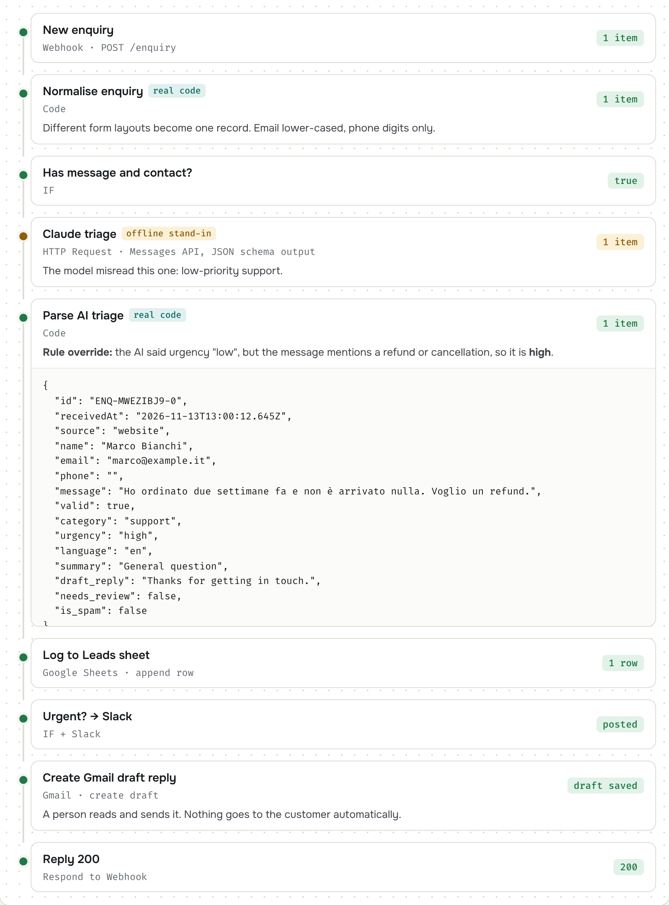
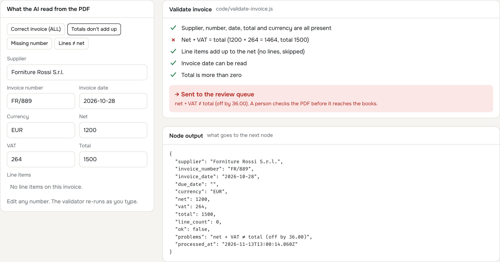
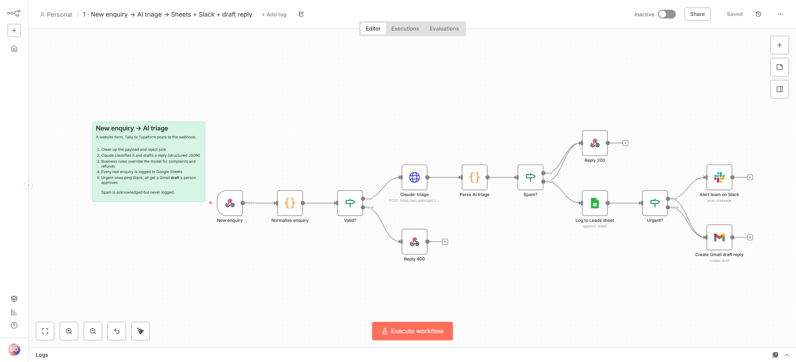
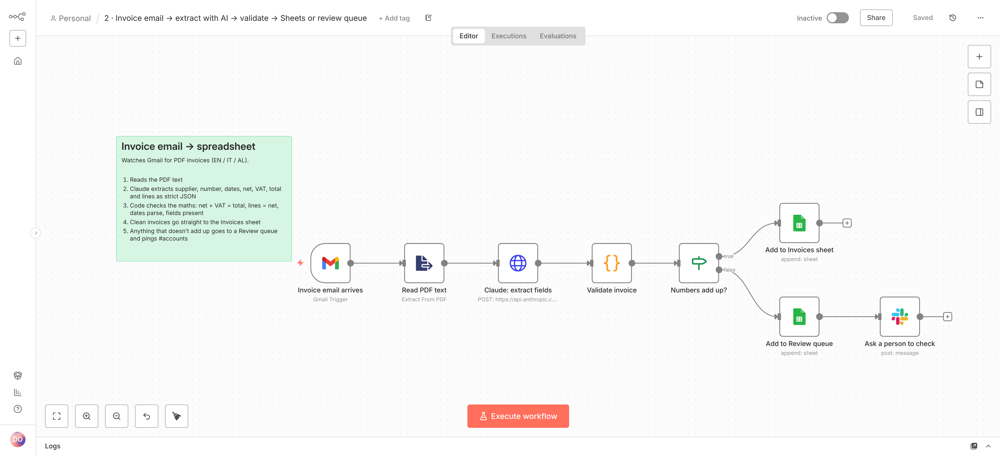
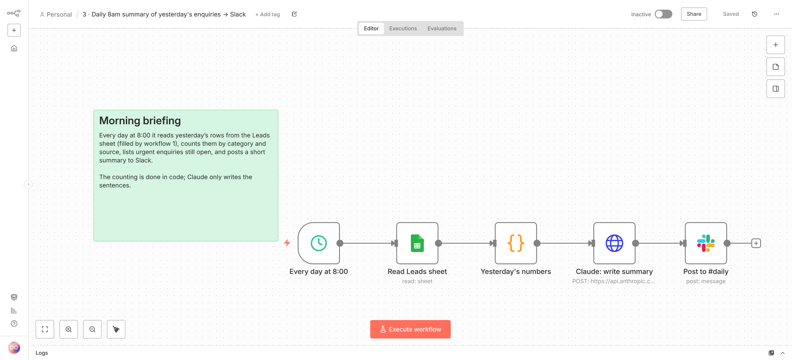
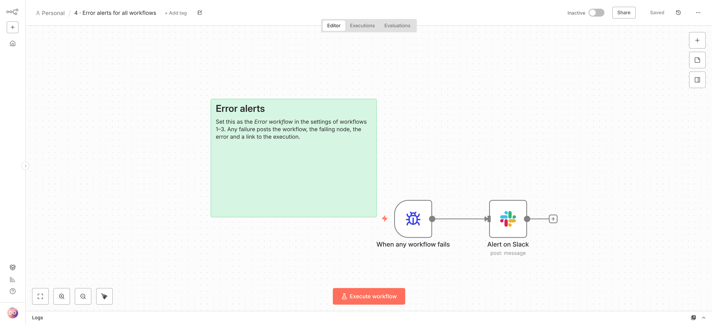

# n8n business automations with AI

Four ready-to-import [n8n](https://n8n.io) workflows that take repetitive admin off a small business: sorting enquiries, typing invoices into a spreadsheet, morning reporting and failure alerts. AI does the reading and writing; plain code checks its work before anything reaches a customer or the books.

Every workflow imports cleanly into n8n 1.123 and the custom logic is covered by tests that run in CI.

**▶ Live demo: https://enxo7899.github.io/n8n-business-automations/** (send an enquiry and watch each node's output, then pick "Refund, AI gets it wrong" to see the rules override the model; the second tab validates invoices as you edit them)

The demo runs the real Code node files from `code/` in your browser. The Claude step is replaced by an offline stand-in that returns the same JSON shape, so no API key is needed and nothing leaves the page.

| The rules overrule a wrong AI answer | Invoices that don't add up go to review |
|---|---|
|  |  |



## The workflows

### 1 · New enquiry → AI triage → Sheets + Slack + draft reply
`workflows/1-enquiry-triage.json`

A website form, Tally or Typeform posts to the webhook.
1. **Normalise**: different form layouts become one clean record; anything without a message and a valid email or phone gets a 400.
2. **Claude triage** (structured JSON output): category, urgency, language, one-line summary and a draft reply in the customer's language.
3. **Business rules override the model**: complaints, refunds, cancellations and legal words are always urgent; unknown categories go to manual review; if the AI call fails the enquiry is still logged.
4. **Log** every real enquiry to Google Sheets (spam is acknowledged but not logged).
5. **Urgent** ones ping Slack, and every enquiry gets a **Gmail draft** that a person approves before sending.

### 2 · Invoice email → extract with AI → validate → Sheets or review queue
`workflows/2-invoice-extraction.json`



Watches Gmail for PDF invoices in English, Italian or Albanian. Claude extracts supplier, invoice number, dates, currency, net, VAT, total and line items. Code then checks the maths (net + VAT = total, lines add up to net, dates parse, required fields present). Clean invoices go straight into the Invoices sheet; anything that doesn't add up lands in a Review queue and pings `#accounts`.

### 3 · Daily 8am summary → Slack
`workflows/3-daily-summary.json`



Reads yesterday's rows from the Leads sheet, counts them by category and source in code, lists urgent enquiries still open, and has Claude write a short morning briefing using only those numbers.

### 4 · Error alerts
`workflows/4-error-alerts.json`



Set it as the *Error workflow* for the others. Any failure posts the workflow, the failing node, the error and a link to the execution.

## Design choices

- **AI reads and writes; code decides.** Routing, urgency rules, validation and counting are deterministic Code nodes. The model can't skip a step or invent a number.
- **Structured outputs.** Claude calls use a JSON schema (`output_config.format`), so replies always parse; there's still a fallback if they don't.
- **A person approves anything customer-facing.** Replies are created as Gmail drafts, not sent.
- **No secrets in the files.** API keys live in n8n credentials; tests fail if a key pattern appears in a workflow.
- **Testable.** Code node logic lives in `code/*.js`, is unit-tested with sample payloads in `samples/`, and is built into the workflow JSON by `scripts/build.mjs`. CI checks the committed workflows match the code.

## Set up

1. In n8n, **Workflows → Import from file** and pick a file from `workflows/`.
2. Create credentials:
   - **Anthropic API key**: type *Header Auth*, name `x-api-key`, value your key.
   - **Google Sheets**, **Gmail** and **Slack** with n8n's built-in OAuth.
3. Replace `YOUR_GOOGLE_SHEET_ID` and the Slack channel names.
4. For workflow 1, point your form at `https://<your-n8n>/webhook/enquiry`.
5. Set workflow 4 as the error workflow in each workflow's settings, then activate.

Sheet columns are mapped automatically from the record fields, so a blank sheet with a header row is enough.

## Develop

```bash
npm test     # rebuilds workflows/ from code/ and runs 11 tests
npm run dev  # demo page on http://localhost:5176 (?run=2 replays the "AI gets it wrong" example)
```

| File | What it is |
|---|---|
| `code/*.js` | Code node sources (normalise, parse AI triage, validate invoice, daily stats) |
| `scripts/build.mjs` | Builds the importable workflow JSON |
| `tests/` | Runs Code nodes outside n8n with mocked `$input` / `$()` |
| `samples/` | Example form payloads and extracted invoices |

## Works with Make or Zapier too

The same pattern (webhook → normalise → AI with a schema → rules → log → notify) maps one-to-one onto Make scenarios and Zapier Zaps. n8n is used here because it can be self-hosted and its workflows can be versioned and tested like code.

---

Built by **[EmSoft](https://github.com/enxo7899)**: AI chatbots, agents and automations for small businesses. Want your workflows automated? Get in touch through my Fiverr or Upwork profile.
